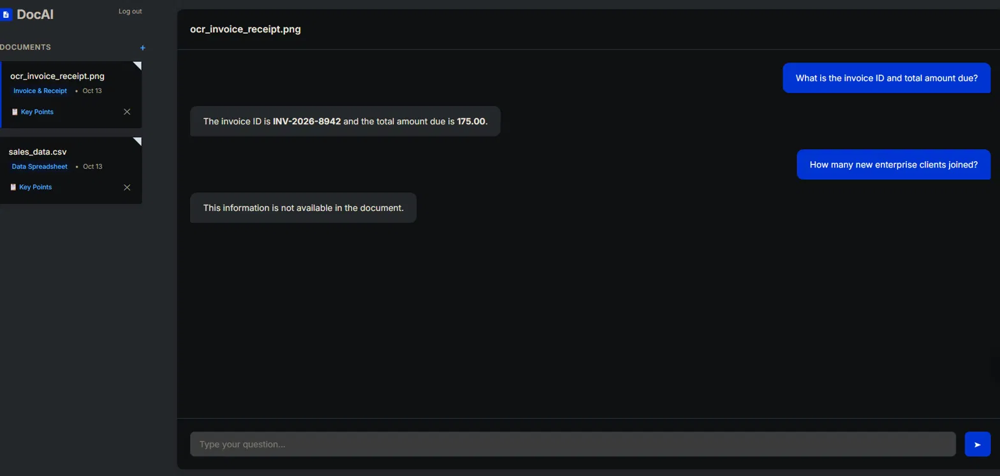
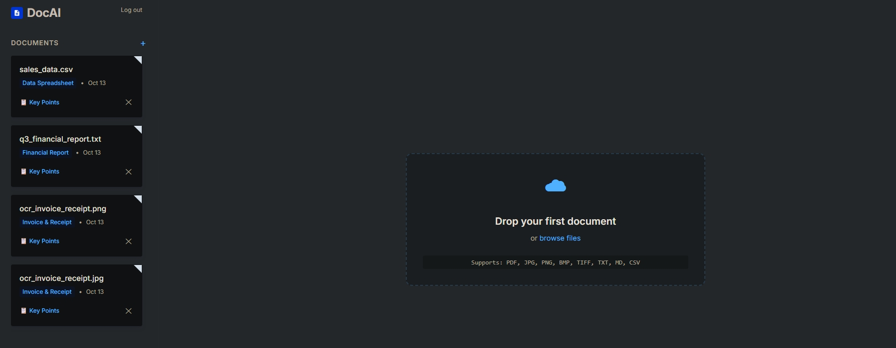

# Document Automation and RAG Service

[](https://www.python.org/downloads/release/python-3110/)
[](https://fastapi.tiangolo.com/)
[](https://www.postgresql.org/)
[](LICENSE)

REST API backend and browser interface for document ingestion, OCR, text chunking, and
retrieval-augmented generation (RAG) Q&A. Developed as an engineering internship project at **ITgate**.

---

## Architecture

```
Client (browser / API consumer)
        |
        v
  FastAPI application
  ├── Auth: static admin token (constant-time comparison) + JWT with per-document ownership checks
  ├── POST /documents/upload  → Tesseract OCR + text extraction
  │       └── Chunk (500 tokens, 50 token overlap) → embed via Gemini → store JSON in PostgreSQL
  ├── POST /chat/{doc_id}     → load chunk embeddings → rank by cosine similarity in Python → Gemini generation
  ├── GET  /metrics           → in-memory per-route counters (reset on restart)
  └── Structured JSON logging via structlog
        |
        v
  PostgreSQL 16 (relational storage; embeddings stored as JSON text)
  (SQLite in CI; PostgreSQL in production)
```

Screenshots (synthetic data only):

| Chat interface | Admin dashboard |
|---|---|
|  |  |

---

## Pilot Evaluation

> **Scope**: 15-item synthetic Q&A benchmark; all document content is fabricated.
> Real-world performance may differ.

### Retrieval (k=2, n=15)

| Method | Precision | Recall | F1 | Hit Rate | MRR |
|---|---|---|---|---|---|
| Semantic (cosine similarity in Python) | 60.0% | 96.7% | 72.2% | 100.0% | 0.933 |
| BM25 (punctuation-stripped) | 60.0% | 96.7% | 72.2% | 100.0% | 0.967 |
| BM25 (whitespace tokens) | 56.7% | 93.3% | 68.9% | 100.0% | 0.933 |
| Chance baseline | 31.7% | 50.0% | 37.8% | 58.9% | 0.575 |

The pilot benchmark cannot separate semantic retrieval from BM25. The marginal gap between semantic retrieval and whitespace BM25 traces to a single test item (`fin-3`) and tokenization handling of punctuation.

### Generation (n=14 evaluated)

| Metric | Value |
|---|---|
| Evaluated items | 14 / 15 (1 item excluded due to a judge call fallback during rate limiting; not a hallucination flag) |
| Faithfulness | 100% |
| Answer Relevancy | 98.6% (~4.93 / 5.0) |
| Judge Agreement | 100% |

- **Generator**: Qwen via Groq (used as an evaluation proxy; the deployed application uses Gemini).
- **Judges**: `gpt-oss-120b` and `allam-2-7b` via API proxy; both judges agree on all 14 evaluated records.
- **Caveat**: Fact-oriented, straightforward benchmark without unanswerable questions, so model refusal behavior is not measured.

See [`scripts/evaluate_rag.py`](scripts/evaluate_rag.py) and [`scripts/rag_eval_results.json`](scripts/rag_eval_results.json).

---

## Limitations

- **No vector index** — embeddings are stored as JSON-serialized lists in PostgreSQL and ranked in-memory via Python cosine similarity; suitable for single-document chunk sets but does not scale to corpus-wide nearest-neighbor indexing without a dedicated vector index or extension.
- **No at-rest encryption** — stored document text and embeddings are unencrypted in PostgreSQL.
- **Metrics reset on restart** — in-memory counters only; no persistent metrics store.
- **OCR accuracy unmeasured** — Tesseract performance depends on scan quality; no formal evaluation performed.
- **Key-info extraction uses regex** — rule-based parser rather than a layout-aware semantic extractor; brittle on non-standard layouts.
- **Lexical fallback when LLM unavailable** — the fallback path serves BM25 results without generation.
- **SQLite in CI, PostgreSQL in production** — CI tests run against SQLite, while production targets PostgreSQL.
- **15-item benchmark** — results are indicative only; held-out test set evaluation not yet performed.

---

## Stack

| Layer | Technology |
|---|---|
| API framework | FastAPI 0.115 |
| Auth | Static admin token + PyJWT (HS256), bcrypt passwords |
| OCR | Tesseract via pytesseract |
| Text chunking | LangChain text splitters (`langchain-text-splitters`) |
| Embeddings | Google Generative AI (`gemini-embedding-001`, 3072-dim) |
| Storage & Ranking | PostgreSQL 16 (JSON text column) + Python cosine similarity |
| Generation | Gemini (production); Qwen via Groq (evaluation) |
| Logging | structlog 25.3.0 (JSON in production, console in dev) |
| Testing | Pytest + SQLite in-memory DB |
| CI | GitHub Actions (test + docker-build jobs) |
| Deployment | Docker Compose (app + postgres:16-alpine) |

---

## Getting Started

### Docker Compose (recommended)

```bash
git clone https://github.com/IsraElAmri/doc-automation-saas.git
cd doc-automation-saas
cp .env.example .env          # fill in GEMINI_API_KEY and SECRET_KEY
docker compose up --build
```

The API will be available at `http://localhost:8000`.
Interactive docs: `http://localhost:8000/docs`

### Manual setup

```bash
python -m venv .venv
.venv\Scripts\activate        # Windows
pip install -r requirements.txt

# Set environment variables (see .env.example)
# Start PostgreSQL, then:
uvicorn app.main:app --reload
```

### Run tests

```bash
pytest                        # uses SQLite; no external services required
```

---

## Repository Layout

```
app/
  main.py            FastAPI app and route registration
  auth.py            Token and JWT authentication
  models.py          SQLAlchemy ORM models
  ocr_utils.py       Tesseract OCR and text splitting helpers
  llm_utils.py       Embedding generation, cosine retrieval, and Q&A
  logging_config.py  structlog configuration
config/
  settings.py        Environment-driven settings (CHUNK_SIZE=500, CHUNK_OVERLAP=50)
scripts/
  evaluate_rag.py    RAG evaluation script
  rag_eval_results.json  Pilot evaluation results
tests/               Pytest suite (SQLite backend)
docs/screenshots/    UI screenshots (synthetic data)
docker-compose.yml
.github/workflows/ci.yml
```

---

## License

MIT © 2026 Isra El Amri
